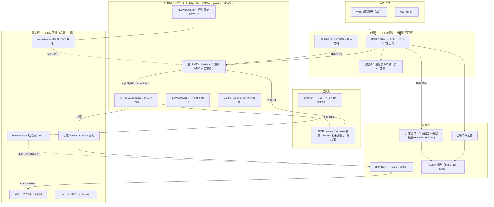
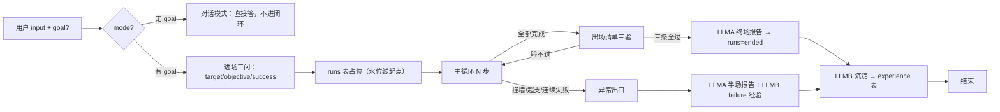
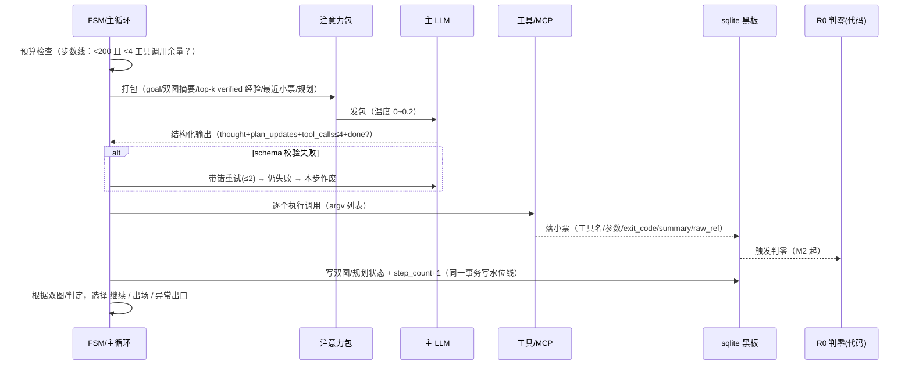
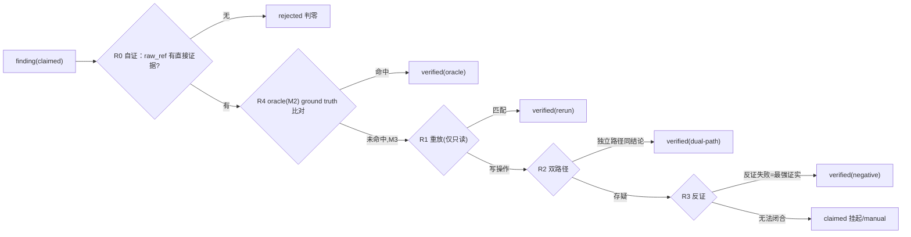
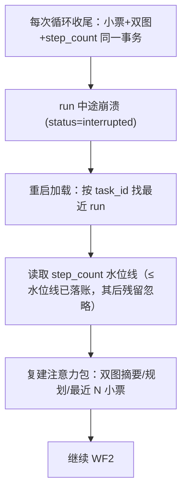

# 渗透测试智能体 · 开发文档 v0.1

| 项 | 值 |
|----|----|
| 依据 | `docs/pentest-agent-goals-requirements-v0.1.md`（图纸，设计层已收口） |
| 定位 | 薄骨架 + 可插拔器官：**FSM 管状态、黑板管证据、Guard 管动作、verify 管真伪** |
| 读者 | 开工前的实现者；本文以 M1 起步、M2/M3 开关表约束范围 |
| 冲突裁决 | 本文与需求文档冲突时，以需求文档为准，差异记回本档"修订史" |
| 总原则 | M1 流程通 → M2 诚实运转 → M3 重装上膛；M1 只保最小闭环，其余占位不装饰 |

---

## 目录

1. 项目定位与设计原则
2. 总体架构（分层图 / 数据流 / 模块职责）
3. 核心概念与数据模型
4. 工作流（十条全链工作流）
5. 数据库设计（六表 + 三表 + 经验表 + 审计表 DDL）
6. 接口契约（LLM 接口层 / 模块 API / CLI 面）
7. 配置与安全
8. 可观测性设计
9. 错误处理：分层异常 + 错误矩阵
10. 测试策略与验收
11. 里程碑与任务拆分
12. 风险登记册与回退
附录 A 术语表 / 附录 B 修订史

---

## 1. 项目定位与设计原则

### 1.1 一句话定位

一个自研的渗透测试智能体 harness：LLM 负责聪明，骨架负责不犯低级错误。骨架约两百行可读完，器官（裁判/经验/教练/探针）逐期插上。

### 1.2 四铁律（不可违反，评审一次钉一次）

| 铁律 | 一句话 | 工程落点 |
|------|--------|----------|
| FSM 管状态 | 进场 → 干活 → 出场/异常，唯一定态处 | `core/fsm.py`，状态迁移必须显式 |
| 黑板管证据 | 一切"事实"锚 sqlite 小票/observations，锚不上 = 臆测 | 双图/小票/observations append-only |
| Guard 管动作 | 动作分级 + 拦截点在 MCP 调用前（M3 生效，M1 占位） | `tools/guard.py` 包裹层 |
| verify 管真伪 | 说得像 ≠ 是；verified 才进报告，误报即事故 | `judge/` R0-R4 流水线 |

### 1.3 工程约束（全项目生效）

- **双引擎对表**：事件线（LLMC 唤醒/失速拉铃，读双图变化判"要不要救"，不管钱）与步数线（200 步循环预算，管钱不判好坏）各管各，不混。M1 实现里二者由 `core/budget.py` 与 `core/stall.py` 分列。
- **判定与算术归代码**：判零、判票、判有用全部代码实现；只有"换思路提案"归 LLMC，且只提案不裁决。
- **安全最低线**：对外部命令一律 argv 列表执行，禁 `shell=True`；密钥只走环境变量与 `.env`，硬编码即事故。
- **数据驱动**：目标/靶场 ground truth/阈值/全部默认参数走配置文件（`harness.yaml`/`profile.toml`），不硬编码。
- **写入口纪律**：`experience` 全库唯一写者 = LLMB 收尾；小票/findings/双图只由 `store` 写；谁都能读，越权写即 bug。
- **纯代码视角可测**：LLM 全部走 FakeLLM 可替换；任何强依赖真实 LLM 的路径不允许进单测。

### 1.4 三层记忆概念（上下文模型）

| 层 | 载体 | 生命周期 | 制造处 |
|----|------|---------|--------|
| 工作记忆（注意力包） | 打包对象 | 每步现打包，跑完即弃 | `store/attention.py` |
| 战役记忆 | sqlite 黑板 | 本 run（task_id） | `store/*` 全族 |
| 长期记忆 | `experience` 表 | 跨 run | **唯 Distiller 收尾写**（M2 激活） |

### 1.5 器官的正式命名（集体名词 + 角色名）

本文在讨论阶段沿用的"主 LLM / LLMA / LLMB / LLMC / worker"是代号；**正式的集体名词 = LLM 器官（LLM Organs）**——挂接在同一接口层、同一 provider 协议下的五个角色化组织，各司一职。正式角色名如下，代码注释/审计 actor/文档一律用角色名，代号只在讨论时使用：

| 代号 | 正式角色名 | 职责 | 审计 actor |
|------|-----------|------|-----------|
| 主 LLM | **Orchestrator**（编排者） | 规划 A/B/C、注意力包消费、决定走/停/派单 | `main` |
| worker | **Sub-agent**（子智能体） | 领单执行，产出结构化小票与 findings | `workerA` |
| LLMC | **Coach**（教练） | 失速/瓶颈时读双图提"换思路"提案，只提案不裁决 | `llmc` |
| LLMA | **Reporter**（报告官） | verified-only 终场/半场报告，verdict 只转述不转写 | `llma` |
| LLMB | **Distiller**（经验蒸馏师） | 本 run 账本 → 八字段经验条目，全库唯一写者 | `llmb` |

裁决类算法（R0/R4、判零、判票、useful_count）**不占器官名额**——它们是纯代码裁判，不是 LLM 器官。

---

## 2. 总体架构

### 2.1 五层架构图



### 2.2 主数据流（一个 run 的生命周期）



### 2.3 模块职责表（M1 落地形态）

| 模块 | 文件 | 职责一句话 | 让正确性可验证的点 |
|------|------|-----------|-------------------|
| 协调层 | `core/fsm.py` | 四态机 + 显式迁移 | 状态迁移必须由事件驱动，非法迁移即抛错 |
| | `core/loop.py` | "一步 = 主 LLM 一次循环"编排 | FakeLLM 可脚本化全路径 |
| | `core/budget.py` | 步数线（200 步、≤4 工具、撞限分支） | 纯函数，单测直测 |
| | `core/stall.py` | 失速计 N=5 埋点（M2 拉铃） | 计数器纯逻辑 |
| | `core/checkpointer.py` | 水位线断电续跑 | kill 后重启可续 |
| 智能层 | `llms/client.py` | 统一 chat 协议 + 结构化 schema 重试 | FakeLLM contract test |
| | `llms/main_llm.py` / `worker.py` | 规划/领单出小票 | 注入式，无全局状态 |
| | `llms/coach.py`(M2) / `reporter.py` / `distiller.py` | 提案/报告/沉淀 | 均无状态，小票进出 |
| 工具层 | `tools/registry.py` | manifest+hash 声明 | schema 校验失败计数 |
| | `tools/mcp_client.py` | MCP 客户端 | argv 列表，无 shell |
| | `tools/probe.py`(M3) | 流量抓包 | wrapper 注入 |
| 事实层 | `store/schema.sql` | DDL+幂等 migration | schema_version 整数递增 |
| | `store/ledger.py` / `dualgraph.py` | append-only 读写 | 越权写直接报错 |
| | `store/attention.py` | 注意力包（三态规则） | 纯函数 |
| 裁判层 | `judge/r0_self.py` / `r4_oracle.py` / `r123.py`(M3) | 判零流水线 | 预置 good/bad fixtures |
| 收尾层 | `finalize/exit_checklist.py` / `reporter.py` / `experience.py` | 三验/报告/沉淀 | Fake 数据可验，死循环 lockout |
| 可观测 | `ob/cli_view.py`(M1) / `web_view.py`(M2) | 角色气泡+小票摘要 | 事件流契约测试 |
| 入口 | `main.py` | CLI 唯一入口 | `secpt` 命令 |

**分层依赖红线**：`core → llms → tools/store → judge → finalize`，单向；禁止上层 import 下层之下层；禁止旁路绕过 store 直写 sqlite。

---

## 3. 核心概念与数据模型

### 3.1 小票（Ticket）——对象的"回执"

每次工具调用的结构化回执，三字段必填：`raw_ref`（raw 产物指针）/ `exit_code` / `summary`（一行，喂注意力包）。小票是全系统唯一可标"它发生过"的凭据，append-only。

### 3.2 finding——台账条目

渗透结论条目，`claimed → verified/rejected` 状态机。裁决五字段：

| 字段 | 说明 |
|------|------|
| `verify_state` | claimed / verified / rejected |
| `method` | rerun / dual-path / negative / oracle / manual / NULL |
| `evidence_ref` | 锚点：优先锚 `observations`（M3），其次小票 raw_ref |
| `confidence` | 0~1 |
| `judged_at` | 判定时间 |

纪律：`claimed` 完全允许在图里到处用做线索，但它**进不了报告、进不了"正典进包"**。臆测即事故——此等级制度严格执行。

### 3.3 双图（资产图 + 探索图）

- **资产图**（asset graph）：target/rce/服务端口/服务/已知漏洞/攻击面，节点 kind=`asset`。
- **探索图**（exposure graph）：已尝试路径/失败路径/当前 frontier，节点 kind=`step`。
- 复合可加 `hypo`（理论架）与 `finding` 节点。edge 建立在节点间，附 `version` 防漂移。
- 双图变更 = 事件源的唯一输出（事件线唯一消费者=LLMC）。

### 3.4 经验库（M2）八字段与三态进包规则

| 字段 | 说明 |
|------|------|
| environment | **命根①** lab 经验禁原样搬家 |
| verify_state | **命根②** 只判真当正典 |
| useful_count | **命根③** 命中率=质量裁判 |
| summary / command / raw_ref / task_id / created_at | 其余五字段（claimed 隐藏 command） |

三态进包（写进 `store/attention.py` 的规则级注释）：

| 态 | 打包动作 |
|----|---------|
| verified | 正典进包（含命令字段） |
| claimed | 只当线索（隐藏命令字段，给思路不给命令） |
| 连续 0 命中 | 降级不进包 |

### 3.5 六库分型（三型：文件资产 / 数据库 / 进程）

| 型 | 库 | 存储/版本化 | 写者 | M1 状态 |
|----|----|------------|------|---------|
| 文件资产型 | prompts/skills/角色/知识 | yaml/md + git | 人（M2 后 LLMB 不写） | prompts ✅；其余 M2 后填语料 |
| 数据库型 | 经验库 | sqlite+migration | LLMB 唯一 | 表建、不激活 |
| 进程型 | 工具库 | 进程清单 manifest+hash | 人 | ✅ MCP |
| 知识库（特注） | — | — | — | M1 不单建（读方向被 prompts+MCP resource 覆盖） |

边界引用：**角色 ← skills ← prompts**（上层打包下层，不反向重复，防同一方法论三处重复版本漂移）。

### 3.6 子智能体作为工具（Sub-agent as Tool）

Sub-agent（worker）有**双重身份**：智能层器官（§2.1 L2）+ 可调用工具（本节）。双重身份的分工是——

| 端 | 触达路径 | 谁能触发 |
|----|---------|---------|
| 器官面 | Orchestrator 代码编排直调 `worker.run(mission)`（§6.1） | FSM 编排层 |
| 工具面 | `tools/registry` 登记为**内嵌工具** `agent_run`，主 LLM 在 tool_calls 里像调 nmap 一样点名调用 | 主 LLM（≤4 tool_calls 约束同样算数） |

**登记契约**（manifest 级，与 MCP 工具同一张注册表，多一类 kind）：

```
name = "agent_run"
kind = "in-process"        # 区别于 mcp；进程内工具，无 hash（代码随版本走）
input_schema = {
  mission: str,            # 一句任务书（含预估步数上限）
  persona: str,            # 角色（读 角色←skills←prompts 语料）
  step_budget: int,        # 本单内部步数预算（上限，超了按 E_TOOL_FAIL 落票）
}
output = 结构化小票（summary=FindingList 摘要；findings 照常入台账由 Sub-agent 直写 store）
```

**四条对表规则**（防双引擎被冲乱）：

1. **预算分层**：主循环调 `agent_run` 只花 1 次工具调用额度（≤4 约束内）；Sub-agent 内部循环走 `step_budget` 自算，**不占 200 步主预算**——但 `agent_run` 单次执行时长有 wall-clock 上限，超时按 E_TOOL_FAIL 落小票。
2. **禁递归**：Sub-agent 的 tool_calls 里**不得出现 `agent_run`**（registry 对 in-process 工具按调用栈拒绝），防套娃派单。
3. **可观测统一**：`agent_run` 调用照落主循环小票（audit actor=`main`），Sub-agent 内部各步小票 audit actor=`workerA`——账本按 actor 分层，出场三验"账本交齐"同时覆盖两层。
4. **Guard 同权**：M3 起 `agent_run` 与外部工具一样过 Guard 调用前检查点（HIGH 级）。

### 3.7 配置模板（两张档案）

```yaml
# configs/harness.yaml
run:
  max_steps: 200              # 步数线
  max_tools_per_step: 4
stall:
  n: 5                        # 失速计拉铃阈值
llm:
  provider: deepseek          # 可换 openai/anthropic/local
  temperature_plan: 0.2
  temperature_freestyle: 0.8  # CTF 撞墙发散档
resume:
  enabled: true
observe:
  mode: cli                   # cli(M1) | web(M2)
judge:
  enabled: false              # M2 打开 R0/R4
probes:
  enable_http_probe: false    # M3
```

```toml
# configs/profile.toml（靶场档案：每任务显式，唯一锁死的边界声明）
target = "127.0.0.1"
platform = "ctf"
ground_truth = [              # R4 oracle 清单（M2）
  { id = "CVE-2021-44228", pattern = "log4j rce" },
]
scope_notes = "M1 不做 scope 检查（占位）"
```

---

## 4. 工作流（十条全链）

> 编号 WF1~WF10，每条含：触发 / 参与者 / 正常路径 / 落账 / 失败路径。实现者按条开发+测试。

### WF1 进场（goal 分模式）

- **触发**：用户提交 input。
- **参与者**：主 LLM、FSM、runs 表。
- **正常路径**：
  1. 解析 input：无 goal → 对话模式（不进闭环，直接答+可观测流）；
  2. 有 goal → 进场三问固化：`{target, objective, success_criteria}`（缺项向用户追问）；
  3. 写 `tasks` + `runs`（status=running，step_count=0），进 FSM=干活。
- **失败路径**：解析失败 → 对话模式兜底（不悬死）。

### WF2 主循环·一步（核心工作流，=主 LLM 一次 LLM 循环）



- **失败路径**：LLM 超时→指数退避≤3→转异常出口；工具连续失败→入失速计。
- **防抖五件**：M1 生效三件（schema 带错重试≤2 / 温度分档规划 0~0.2 发散 0.8 / 超时退避≤3）；M2 补齐两件（重复抑制：同一 tool_call 连续重复则去重并计失速；幻觉防线：thought 引用的证据必须锚到黑板小票/双图，锚不上视为臆测不入包）。

### WF3 工具执行与小票

- **触发**：主循环解析出的 tool_calls。
- **参与者**：`tools/registry` 校验 manifest schema → `mcp_client` dispatch → 小票追加。
- **判零入口直插刻点**：工具结果回抢初步 flag：M2+判零在调用尾部立即红笔判零（R0 自证；M3 加流量通道 B）。
- **失败路径**：schema 不合=E_SCHEMA_PLUGIN（记审计，不重试）；执行失败 exit_code≠0=E_TOOL_FAIL（照落小票，不给"失败即目标不存在"的倾向性语义）。

### WF4 判零与裁判（R0→R4）



- **纪律**（代码注释级）：判零纯代码；LLM 裁判必须 new session；**永不 rerun 写操作**。
- **失败路径**：每道裁判自己不会 throw 破坏状态，只改变 findings 状态。

### WF5 失速与 LLMC 介入（M2）

- **触发**：失速计 N=5 拉铃（连续 5 轮规划无实质变化/连续判零/连续失败）或双图变化事件线。
- **路径**：`coach.propose(graphs, plan) -> Proposal`（只提案不裁决）→ 主 LLM 下一包吸收 → 管道返回 WF2。
- **失败路径**：提案吸收后仍 N=5 → 异常出口。

### WF6 出场清单三验

- **触发**：规划全部 done。
- **三条逐条验过才允许结束**：
  1. 账本交齐：小票与双图一致（有图节点无对应小票 = 账目缺口）；
  2. verified findings 清点：全部 findings 有终态（无 claimed 悬置）；
  3. 交付对目标：goal 的 success_criteria 逐条比对，命中与否如实上报。
- **失败路径**：任一条不过 → 弹回 WF2（有上限：连败 3 轮直接走异常出口，防纠缠循环）。

### WF7 异常出口

- **触发**：撞墙（连续判零/连环失败）/ 超支（步数线撞限）/ 崩溃（E_CRASH，走续跑路径而非直接杀）。
- **两条硬性动作**：
  1. LLMA 半场报告（已完成 verified 部分，结构化同终场）；
  2. LLMB 失败经验沉淀，`environment=lab`（如实标记来源环境，供下次检索降噪但永不满血搬家）。
- **落账**：tasks.exit_kind=abnormal/stalled，runs=ended。

### WF8 断电续跑



- **纪律**：只复建不回放——不去重放旧步骤；水位线以内（≤ step_count）已落账的不再重复执行，水位线以后的残留一律忽略。

### WF9 报告生成（LLMA）

- **输入**：**verified-only** findings + 出场/异常双方的 failing count 数字。
- **输出**：结构化 JSON（FindingList）+ 人类可读 Markdown 段。半场报告走同一 schema，外加 `half_court: true` 标记。
- **纪律**：LLMA 不提供新发现，只对 verdict 转述不转写（不得改判）；报告内部任何无锚点 claims 一律进不去——锚点校验是机制硬规，不是文档约定。

### WF10 经验沉淀（LLMB，M2）

- **输入**：本 run 全账本（含失败路径）。
- **输出**：八字段 ExperienceEntry[]。
- **纪律**：全库唯一写者；claimed/failed 条目照沉淀但 `verify_state`+`environment` 如实标注，永不满血搬家。

---

## 5. 数据库设计（六表 + 三表 + 经验表 + 审计表 DDL）

单文件单库；每表带 `task_id`（多任务并行预留）与 `schema_version` 追加路由；migration 幂等可重跑。M1 建六表（tasks/runs/plans/steps/tickets/findings），M2/M3 建三表（observations/graph_nodes/graph_edges）；`experience`/`audit_log` 随 M2 激活（audit_log M1 即启用）。

```sql
-- schema_version = 1
CREATE TABLE tasks (
  id TEXT PRIMARY KEY,                      -- uuid
  input_text   TEXT NOT NULL,
  goal         TEXT,                        -- NULL = 对话模式
  mode         TEXT NOT NULL CHECK (mode IN ('conversation','pentest')),
  exit_kind    TEXT CHECK (exit_kind IN ('normal','abnormal','stalled')),
  created_at   INTEGER NOT NULL
);

CREATE TABLE runs (                        -- 断电续跑的锚
  id TEXT PRIMARY KEY,
  task_id      TEXT NOT NULL REFERENCES tasks(id),
  status       TEXT NOT NULL DEFAULT 'running'
               CHECK (status IN ('running','paused','interrupted','ended')),
  step_count   INTEGER NOT NULL DEFAULT 0,  -- 水位线
  config_json  TEXT NOT NULL,               -- 本次 run 参数快照
  started_at   INTEGER NOT NULL, ended_at INTEGER
);

CREATE TABLE plans (
  id TEXT PRIMARY KEY,
  task_id    TEXT NOT NULL REFERENCES tasks(id),
  step_no    INTEGER NOT NULL,
  content    TEXT NOT NULL,                 -- A/B/C… 一句规划
  parent_id  TEXT,                          -- 规划重排时指向上版
  status     TEXT NOT NULL DEFAULT 'active'
             CHECK (status IN ('active','done','cancelled','failed')),
  version    INTEGER NOT NULL DEFAULT 1,
  updated_at INTEGER NOT NULL
);

CREATE TABLE steps (
  id TEXT PRIMARY KEY,
  task_id TEXT NOT NULL, run_id TEXT NOT NULL REFERENCES runs(id),
  step_no INTEGER NOT NULL,
  plan_refs  TEXT NOT NULL,                 -- json: [plan_id,...]
  llm_output TEXT NOT NULL,                 -- 结构化输出原文（审计）
  status  TEXT NOT NULL CHECK (status IN ('ok','schema_retry','voided','aborted')),
  started_at INTEGER, ended_at INTEGER
);

CREATE TABLE tickets (                     -- 小票（append-only）
  id TEXT PRIMARY KEY,
  task_id TEXT NOT NULL, run_id TEXT NOT NULL, step_id TEXT NOT NULL,
  tool_name  TEXT NOT NULL,
  args_json  TEXT NOT NULL,
  exit_code  INTEGER,
  summary    TEXT NOT NULL,
  raw_ref    TEXT NOT NULL,
  created_at INTEGER NOT NULL
);

CREATE TABLE findings (                    -- 台账：claimed→verified/rejected
  id TEXT PRIMARY KEY,
  task_id TEXT NOT NULL,
  title    TEXT NOT NULL,
  detail   TEXT NOT NULL,
  verify_state TEXT NOT NULL DEFAULT 'claimed'
       CHECK (verify_state IN ('claimed','verified','rejected')),
  method    TEXT CHECK (method IS NULL OR method IN ('rerun','dual-path','negative','oracle','manual')),
  evidence_ref TEXT NOT NULL,
  confidence REAL, judged_at INTEGER,
  created_at INTEGER NOT NULL
);

-- —— 三表：M2/M3 建 ——
CREATE TABLE observations (                -- 流量真相：LLM 小票之外的客观事件流
  id TEXT PRIMARY KEY,
  task_id TEXT NOT NULL, run_id TEXT NOT NULL,
  channel TEXT NOT NULL,                    -- http | tcpdump
  meta_json TEXT NOT NULL,
  snapshot_ref TEXT NOT NULL,               -- 原始报文文件指针
  ts INTEGER NOT NULL
);

CREATE TABLE graph_nodes (
  id TEXT PRIMARY KEY, task_id TEXT NOT NULL,
  kind TEXT NOT NULL CHECK (kind IN ('asset','hypo','step','finding')),
  key TEXT NOT NULL, props_json TEXT NOT NULL,
  version INTEGER NOT NULL DEFAULT 1, updated_at INTEGER NOT NULL
);
CREATE TABLE graph_edges (
  id TEXT PRIMARY KEY, task_id TEXT NOT NULL,
  src TEXT NOT NULL, dst TEXT NOT NULL, kind TEXT NOT NULL,
  version INTEGER NOT NULL DEFAULT 1, updated_at INTEGER NOT NULL
);

CREATE TABLE experience (                  -- 长期记忆（M2 激活）：谁都能读/唯 LLMB 写
  id TEXT PRIMARY KEY,
  task_id TEXT NOT NULL REFERENCES tasks(id),
  environment TEXT NOT NULL,
  verify_state TEXT NOT NULL,
  useful_count INTEGER NOT NULL DEFAULT 0,
  summary   TEXT NOT NULL,
  command   TEXT,
  raw_ref   TEXT NOT NULL,
  created_at INTEGER NOT NULL
);

CREATE TABLE audit_log (
  id INTEGER PRIMARY KEY AUTOINCREMENT,
  task_id TEXT NOT NULL,
  actor TEXT NOT NULL,                      -- main/workerA/llmc/llma/llmb/judge
  what TEXT NOT NULL, created_at INTEGER NOT NULL
);
```

**写入口纪律**（重申为机制而非约定）：tickets/findings/graphs/observations 只经 `store/*.py`；`experience` 唯写=LLMB；audit_log 每处显式调用，不得 omit。

---

## 6. 接口契约（先纸面签字再写代码）

### 6.1 LLM 接口层（`llms/client.py`）

所有器官同一协议，provider 一换全换；`Any` 仅允许在 LLM 响应边界出现。

| 接口 | 签名 | 输入上下文 | 输出契约 | 纪律 |
|------|------|-----------|---------|------|
| 主 LLM·一步 | `main_llm.step(pkg: AttentionPack) -> StepOutput` | 注意力包 | `{thought, plan_updates[], tool_calls[](≤4), done?}` | pydantic schema 失败重试≤2 |
| 主 LLM·进场 | `main_llm.entrance(input) -> Goal` | 用户输入 | `{target, objective, success_criteria}` | 缺项追问 |
| Sub-agent·领单 | `worker.run(mission: Mission) -> FindingList` | 本单上下文+角色+skills+预估步数 | 结构化小票 | 无全局状态；同时以 `agent_run` 内嵌工具登记（§3.6） |
| LLMC·提案 | `coach.propose(graphs, plan) -> Proposal \| None` | 双图变化摘要 | 提案内容+理由 | 只提案不裁决 |
| LLMA·报告 | `reporter.generate(findings, mode) -> Report` | verified-only | 结构化 JSON + MD | 锚不上的字段不进 |
| LLMB·沉淀 | `distiller.summarize(run_ledger) -> ExperienceEntry[]` | 本 run 账本 | 八字段条目 | 唯写者 |
| 裁判 | `judge.r0(f) -> Verdict`, `r4(f) -> Verdict` | finding+raw_ref | 裁决五字段 | new session，纯代码 |
| 出场 | `exit_checklist.run(task) -> Pass \| Fail(+ reason)` | 全账本 | 逐条 verdict | 不过即弹回 |

### 6.2 模块级 API 概表

| API | 用途 |
|-----|------|
| `store.ledger.append_ticket(...)` / `record_finding(...)` | append-only 写 |
| `store.dualgraph.write_nodes/edges(...)` | 带版本写 |
| `store.attention.build(pkg_spec)` | 三态规则进包 |
| `core.budget.try_spend(n=1)` / `try_tool_calls(count)` | 步数线纯函数（预算不足即 False，不抛错） |
| `core.checkpointer.mark_step(run_id, n)` | 同事务水位线 |
| `tools.registry.dispatch(name, args)` | schema 校验→dispatch→小票 |
| `judge.sweep()` | 批量推进 findings 状态（M2） |

### 6.3 CLI 面（M1）

```
secpt run --goal "..."          # 渗透任务模式
secpt chat                      # 对话模式
secpt resume <task_id>          # 断电续跑
secpt tools                     # 列工具（MCP 含 manifest hash；agent_run=内嵌工具）
secpt evidence <task_id>        # 小票/findings/双图 落地检查窗
```

---

## 7. 配置与安全

| 主题 | 约定 |
|------|------|
| 密钥 | 仅环境变量 + `.env`（gitignore）；`LLM_PROVIDER=mock` 可离线演示 |
| 命令执行 | argv 列表，无 shell 解释；拒绝控制字符注入 |
| 权限 | 每个角色/worker 最小工具集（白名单制，不做黑名单） |
| 输出截断 | 工具输出长度上限（default 8KB/小票）与总结句并行 |
| scope | M1 占位；M3 Guard 分级(HIGH/MID/LOW)+人工弹窗 |
| 合规底线 | 渗透工具=攻击载荷；没有 Guard 就没有合规底线，该名言写进 Security 章节首 |

---

## 8. 可观测性设计

| 面 | M1 (cli) | M2 (web) |
|----|----------|----------|
| 对话面板 | 角色气泡（主 LLM/worker 各自标签） | 同 M1 + LLMC 标签 |
| 小票摘要卡 | 一行 summary（工具名/状态） | 转成面板卡片 |
| CLI 命令 | `run/chat/resume/tools/evidence` | web 同源 |
| 日志 | structlog 结构化 JSON，全步数记频道 | 同 |
| 审计 | audit_log 表（who/when/what） | 同 |
| 运行回放 | evidence 命令查账本 | 面板回放（M2.5） |

事件流（M2 web 用）：`run_step_started` / `ticket_appended` / `finding_verdict` / `stall_alarm` / `exit_passed|failed` / `run_ended`——全部由 store/loop 触发，`ob/*` 只读订阅。

---

## 9. 错误处理：分层异常 + 错误矩阵

异常分层：`LedgerError / McpError / JudgeError / LlmError`（各自带 `code`+`context`），库层不吞错、统一上抛；`main.py` 兜底捕获转异常出口，绝不让循环悬死。

| 错误类 | 归因 | 处置 | 落账 |
|--------|------|------|------|
| `E_SCHEMA` | LLM 输出不合 schema | 带错重试≤2 → voided 记审计 | steps.status |
| `E_TIMEOUT_LLM` | LLM 超时/无响应 | 指数退避≤3 → 异常出口 | audit_log |
| `E_TOOL_FAIL` | 工具 exit_code≠0 | 照落小票+失速计+1 | tickets |
| `E_SCHEMA_TOOL` | 工具入参不合 manifest | 判零记"工具错"，不等于目标不 vuln | tickets.summary |
| `E_BUDGET_EXHAUSTED` | 步数撞限 | **停执行→异常出口** | runs.status |
| `E_STALL` | 失速计 N=5 | WF5 提案；改不回→异常出口 | audit_log |
| `E_WALL` | 连环判零/失败 | 同上 | findings.rejected |
| `E_CRASH` | 进程崩溃 | WF8 续跑（复建不回放） | runs.status=interrupted |

---

## 10. 测试策略与验收

| 层 | 方法 | 覆盖目标 |
|----|------|---------|
| 主循环/预算器 | FakeLLM 脚本化（第 N 步返回什么），纯函数直测 | 200 步撞限/≤4 工具/三验/异常全路径 |
| LLM 接口层 | contract test：FakeLLM 固定响应 fixture | schema 重试/温度分档/超时退避 |
| 事实层 | 预置账本 fixture | append-only 越权写红灯；三验/结论 |
| 裁判 | good/bad raw_ref fixture + seed profile.toml | R0 判零边界；R4 命中/不命中 |
| 断电续跑 | 跑 10 步→kill→重启 | 水位线恢复、注意力包复建不回放 |
| e2e | vulhub 单靶 | M1 验收对照 |

**验收三杆**（全部可证伪数字）：

| 杆 | 定义 | 关卡 |
|----|------|------|
| 稳定杆 | 单靶 4h 全链任务不塌 | M1 |
| 精度杆 | verified 阳性率 ≥90% | M2 |
| 复利杆 | 二次打同类目标经验命中 ≥50% | M2.5 之后 |

---

## 11. 里程碑与任务拆分

### M1 流程通（第一周九件产物 + 第二周闭环）

| 周 | 任务 | 产物 |
|----|------|------|
| W1-1 | schema.sql + migrations 幂等 | 六表 DDL（三表/经验表沿 migration 序后补） |
| W1-2 | `llms/client.py` + FakeLLM contract test | 接口契约 |
| W1-3 | `core/loop.py` 主循环骨架 | 进场三问→打包→一步→小票 |
| W1-4 | 工具注册表 + nmap 适配器（唯一工具） | manifest+hash |
| W1-5 | `core/checkpointer.py` 水位线 | kill 测试 |
| W1-6 | 异常分支落地（失速计 N=5 / 一步=一次工具调用 / 撞限=停执行走异常出口） | 配置可调 |
| W1-7 | CLI 可观测 | 气泡+小票摘要行 |
| W2-1 | 出场清单三验 + LLMA 终场/半场 | 结构化报告 |
| W2-2 | 双图读写 pilot | graph_nodes/edges 最简实现 |
| W2-3 | FakeLLM 端到端 | 双向（正常/异常）全走通 |
| W2-4 | M1 里程碑验收 | 五样齐 = 流程通 |

### M2/M3 逐件移植（开关表见前一版，按序）

M2：经验库激活（LLMB 唯写）→ R0/R4 → 失速计+LLMC → web 面板。M3：流量探针 observations 全链 → R1-R3 → HITL/Guard → Docker 隔离 → 多 worker（默认 3）。

---

## 12. 风险登记册与回退

| # | 风险 | 等级 | 缓解 | 回退 |
|---|------|------|------|------|
| R1 | 臆测→经验沉淀→毒性闭环 | 高 | 裁判 R0/R4 先行、claimed 禁报告禁正典 | 没到 90% 不开 M2 裁判前 experience 只读 |
| R2 | M1 施工中图纸走样（做快做歪） | 中 | 验收杆可证伪；诚实边界写死 | 各期回退=开关表回占位 |
| R3 | 双引擎混写（谁触发主循环二义） | 高 | 两文件两测试面隔离 | 事件线 M2 仅落铃不做自动接管 |
| R4 | schema 演进破昨夜数据 | 中 | migration 幂等+version 序增 | schema_version 路由 TLV |
| R5 | MCP 工具质量不可控 | 中 | manifest+hash+schema 校验 | 工具名单进程化退回本地适配器 |
| R6 | 探针引入性能/稳定性偏差 | 中 | M3 单独开关，默认关 | 只捕捉 HTTP（MVP 不做全量 pcap） |
| R7 | 半场报告被用户误当终场 | 低 | half_court 标记+exit_kind 落账 | CLI 显眼告知 |
| R8 | LLM provider 变动拖累主循环 | 中 | 接口层唯一 dep | mock provider 常备 |

---

## 附录 A 术语表

| 术语 | 定义 |
|------|------|
| 小票 (ticket) | 一次工具调用的结构化回执（raw_ref/exit_code/summary） |
| 双图 | 资产图+探索图，事件线唯一消费者 |
| 注意力包 | 每步现打包的工作记忆，跑完即弃 |
| 水位线 | runs.step_count，断电续跑的锚 |
| 判零 | 纯代码判定 finding 无直接证据 → rejected |
| 出场清单 | 三验：账本交齐/verified 清点/对 goal |
| 半场报告 | 异常出口产出的已完成部分报告 |
| 命根①②③ | experience 的 environment/verify_state/useful_count |
| 失速计 | 连续 N=5 轮无实质进展 → LLMC 拉铃 |
| 双引擎 | 事件线（管救/不管钱）+ 步数线（管钱/不管好坏） |
| LLM 器官 | 五个角色化 LLM 组织的集体名词：Orchestrator/Sub-agent/Coach/Reporter/Distiller（§1.5） |
| `agent_run` | 内嵌工具：把 Sub-agent 登记进 tools registry，供主 LLM tool_calls 点名调用（§3.6） |

## 附录 B 修订史

| 版本 | 日期 | 说明 |
|------|------|------|
| v0.1 | 2026-10-28 | 初稿（施工图蓝本） |
| v0.1.1 | 2026-10-28 | 架构师/全栈 综合 rewrite：全链十条工作流、错误矩阵、风险登记册、术语表 |
| v0.1.2 | 2026-10-28 | 器官正式命名（§1.5：LLM Organs 五角色）；新增 §3.6 子智能体作为工具（agent_run 内嵌工具 + 四条对表规则） |

